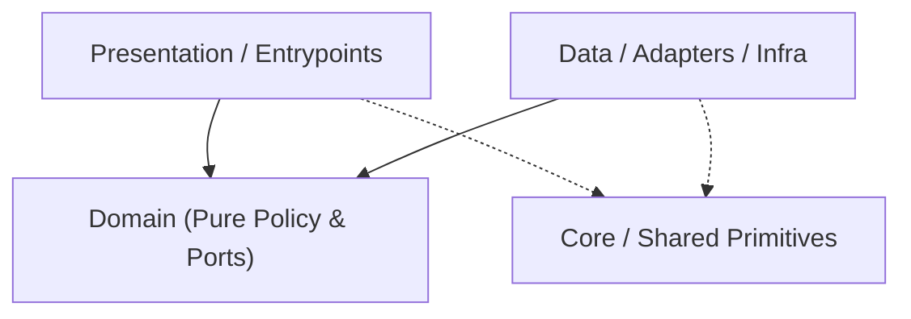

# Codebase Architecture Map — `adb-studio`

> Auto-generated by `project-pro map` (2026-11-08 08:32 UTC). Read this first to save exploration tokens.
- **Detected Stack**: `ios` | **Mode**: `configured`

## 1. Canonical Layer Dependency Flow

## 2. Layer Distribution (Code Files)
- **Domain**: `0` | **Data/Infra**: `0` | **Presentation/UI**: `0` | **Core/Shared**: `0` | **Tests**: `0` | **Other**: `12`

## 3. Module / Directory Index (Top Slices)
- `Sources/` — `12` files (`1350` LOC)
