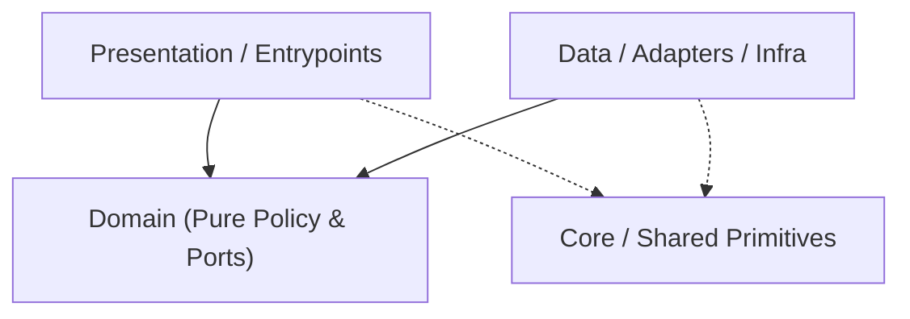

# Codebase Architecture Map — `adb-studio`

> Auto-generated by `project-pro map` (2026-11-08 08:45 UTC). Read this first to save exploration tokens.
- **Detected Stack**: `rust` | **Mode**: `configured`

## 1. Canonical Layer Dependency Flow

## 2. Layer Distribution (Code Files)
- **Domain**: `4` | **Data/Infra**: `8` | **Presentation/UI**: `9` | **Core/Shared**: `0` | **Tests**: `2` | **Other**: `6`

## 3. Module / Directory Index (Top Slices)
- `src/` — `2` files (`35` LOC)
- `src/adapters/` — `8` files (`492` LOC)
- `src/app/` — `4` files (`402` LOC)
- `src/domain/` — `4` files (`135` LOC)
- `src/ui/` — `2` files (`121` LOC)
- `src/ui/components/` — `3` files (`119` LOC)
- `src/ui/views/` — `4` files (`424` LOC)
- `tests/` — `2` files (`58` LOC)
